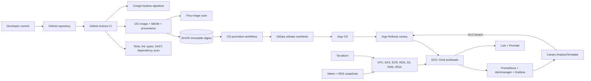

# Platform architecture

## Requirement coverage

| Requirement | Implementation | Primary evidence |
|---|---|---|
| Version control | Conventional Commits, CODEOWNERS, PR template, protected branches, hooks, Dependabot | `CONTRIBUTING.md`, `.github/`, `tools/check_commit_message.py` |
| CI/CD | Pinned GitHub Actions, quality gates, signed immutable images, automated staging and approved production promotion | `.github/workflows/` |
| Containerization | Multi-stage, non-root, read-only, health-checked OCI image; Compose stack | `Dockerfile`, `docker-compose.yml` |
| Kubernetes orchestration | Namespace, rollout, services, ingress, HPA, PDB, NetworkPolicy, migration Job, probes, security contexts | `deploy/gitops/apps/taskflow/base/` |
| Infrastructure automation | Terraform VPC/EKS/ECR/RDS/S3/KMS/IRSA, S3 state bootstrap, Kind bootstrap | `infra/terraform/`, `infra/scripts/bootstrap-local.sh` |
| Monitoring | Custom RED metrics, ServiceMonitor, PrometheusRule, Grafana dashboard, Alertmanager | `app/metrics.py`, `platform/observability/` |
| Logging | JSON logs with trace IDs, Promtail parsing, Loki rules and LogQL runbook | `app/logging.py`, `platform/observability/log-queries.md` |
| Security | CodeQL, Bandit, Gitleaks, Trivy, pip-audit, Cosign, Kyverno, Pod Security, NetworkPolicies, IRSA, External Secrets | `.github/workflows/`, `platform/security/` |
| Advanced deployment | Progressive 20/50/100 canary with Prometheus error-rate, latency and readiness analysis; automatic abort | `rollout.yaml`, `analysis-template.yaml`, `docs/canary.md` |
| Recoverability | Git desired state, rollout revisions, Velero, RDS PITR/snapshots, versioned Terraform state | `platform/backup/`, `runbooks/` |

## Chosen application

TaskFlow is a FastAPI task API with a dependency-free browser UI. It exposes `/healthz`,
`/readyz`, `/metrics`, `/api/v1/info` and CRUD `/api/v1/tasks`. It uses PostgreSQL through
SQLAlchemy and Alembic in deployed environments, and SQLite for isolated tests and local preview.
Every response carries a request ID and W3C `traceparent`; logs are single-line JSON so Loki can
correlate a request across the platform.
