# Dev Ops and Automation

**Lab Manual**

**Submitted by:** Arghyadipta Goswami (Roll 2301010192)<br>
**Section:** C | **Year:** 2023-2027<br>
**Subject:** Dev Ops and Automation<br>
**Degree:** BACHELOR OF TECHNOLOGY (CSE)<br>
**University:** K.R. Mangalam University<br>
**Repository:** [https://github.com/ArghyadiptaGoswami4259/DEV-OPS-Cap-Stone](https://github.com/ArghyadiptaGoswami4259/DEV-OPS-Cap-Stone)

---

## Table of Contents

- Experiment 1: Platform Blueprint and Chosen Application ... 3
- Experiment 2: Version Control and Contribution Workflow ... 5
- Experiment 3: Containerization and Local Runtime ... 7
- Experiment 4: CI Quality Gates and Supply-Chain Security ... 9
- Experiment 5: Infrastructure Automation with Terraform and Kind ... 11
- Experiment 6: Kubernetes Orchestration and Declarative Manifests ... 13
- Experiment 7: GitOps Continuous Delivery and Environment Promotion ... 15
- Experiment 8: Monitoring, Logging, SLO Alerts and Correlation ... 17
- Experiment 9: Security Hardening, Secrets and Policy as Code ... 19
- Experiment 10: Canary Delivery, Rollback and Disaster Recovery ... 21
- Appendix A: Command Reference and Evidence Checklist ... 23
- Appendix B: Viva-Voce Preparation and Production Gate ... 24
- Appendix C: Local Host Implementation Evidence Screenshots ... 25

---

## Experiment 1: Platform Blueprint and Chosen Application

*Design a reproducible commit-to-production DevOps architecture for a cloud-native reference application and identify every feedback loop.*

### Theory

A production delivery platform treats source code, build inputs, deployment state, infrastructure and policy as versioned artefacts. A commit must produce one traceable release identity that can be rebuilt, verified, promoted or rolled back without manual server changes.

TaskFlow is a FastAPI task API with a browser UI, PostgreSQL persistence through SQLAlchemy/Alembic, JSON logs, custom Prometheus metrics and W3C trace correlation. This small workload makes each DevOps control observable without obscuring the pipeline behind application complexity.

### Tools Required

Git, GitHub, Python 3.11+, FastAPI, Docker, Kubernetes, Terraform, Helm, Argo CD, Argo Rollouts, Prometheus, Grafana, Loki, Cosign.

### Algorithm / Procedure

1. Draw the commit-to-production flow and label every trust boundary and artefact store.
2. Choose TaskFlow as the workload and define health, readiness, metrics, logging and metadata endpoints.
3. Map each requirement to a repository path, a CI gate or a Kubernetes object.
4. Define SLOs, recovery objectives and the evidence needed to prove reproducibility.
5. Run the application and the automated test suite to establish a known-good baseline.

### Key Implementation (app/main.py)

```text
app = FastAPI(title='TaskFlow API', lifespan=lifespan)
@app.get('/healthz')
def healthz() -> HealthRead:
    return HealthRead(status='ok', version=settings.version,
                      commit=settings.git_sha,
                      environment=settings.environment)
@app.get('/readyz')
def readyz(db: Session = Depends(get_db)):
    db.execute(select(func.count()).select_from(Task))
    set_ready(True)
    return ReadyRead(status='ready', database='ok')
```

### Verification

- Run pytest -q and confirm all API, metrics and validation tests pass.
- Open /healthz and /readyz and verify version, commit and environment values.
- Open /metrics and verify taskflow_build_info and taskflow_ready are present.
- Check that every response contains X-Request-ID, X-Trace-ID and traceparent.

## Output

| Architecture | Expected evidence |
|---|---|
| **Architecture** | 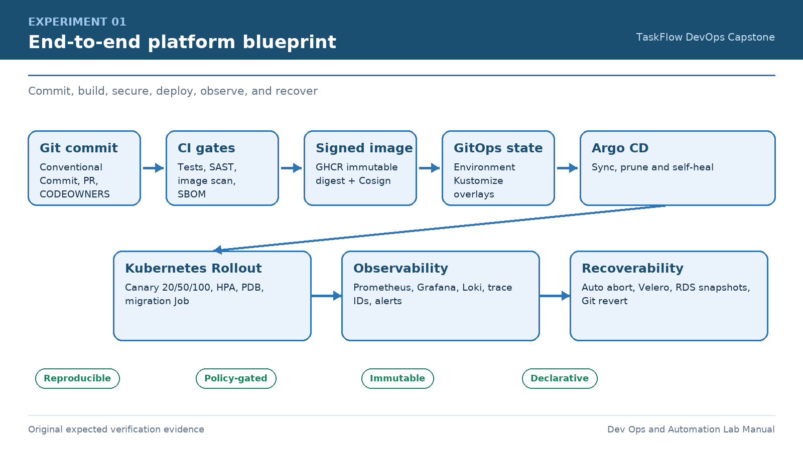 |

*Figure 1.1 - End-to-end platform blueprint with observability and recovery feedback*

### Observations

- A single architecture diagram with explicit build, deploy, observe and recover paths.
- Healthy application UI and OpenAPI documentation in non-production mode.
- Machine-readable evidence that the baseline has a version, commit and environment.

### Result

The chosen application and platform boundaries were implemented. The baseline is testable, identifiable by immutable build metadata, and ready to be placed under automated delivery control.

### Viva Questions

1. Why is an immutable release identity preferable to a mutable latest tag?
2. Differentiate /healthz from /readyz and describe what a failed readiness check means.
3. How does a trace ID connect logs, metrics and a canary decision?

---

## Experiment 2: Version Control and Contribution Workflow

*Configure a traceable Git workflow with protected delivery branches, review ownership, conventional commit messages and local quality hooks.*

### Theory

Version control is the system of record for both application code and operational intent. Short-lived branches, review requirements and deterministic commit messages create an auditable chain from a proposed change to a release digest.

Local hooks provide fast feedback, while server-side branch protection and CI provide an independent gate. CODEOWNERS and a structured pull-request template ensure that security-sensitive paths receive explicit review.

### Tools Required

Git, GitHub, CODEOWNERS, pull-request templates, Conventional Commits, pre-commit hooks, Dependabot, Git tags.

### Algorithm / Procedure

1. Create a feature branch and write a Conventional Commit subject.
2. Install the commit-msg and pre-commit hooks with make hooks.
3. Open a pull request and complete the delivery and rollback checklist.
4. Verify CODEOWNERS, required status checks and signed-artefact evidence.
5. Squash-merge only after review; tag approved releases with an immutable digest.

### Key Configuration (tools/check_commit_message.py)

```text
PATTERN = re.compile(
    r'^(feat|fix|docs|chore|refactor|test|ci|build|perf|revert)'
    r'(\([a-z0-9._/-]+\))?!?: .{1,72}$'
)
subject = Path(message_file).read_text().splitlines()[0]
if PATTERN.match(subject):
    raise SystemExit(0)
print('Commit subject must use Conventional Commits')
raise SystemExit(1)
```

### Verification

- Reject a commit subject that does not follow the Conventional Commit pattern.
- Confirm CODEOWNERS covers workflows, infrastructure, deployment and security paths.
- Confirm GitHub Actions are pinned to full 40-character commit SHAs.
- Inspect Dependabot groups for runtime, development, action and Terraform updates.

## Output

| Branch flow | Expected evidence |
|---|---|
| **Branch flow** | 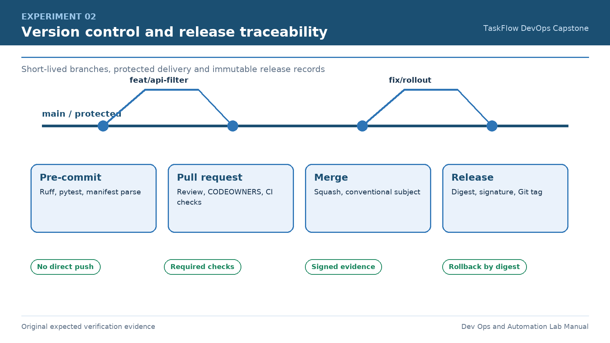 |

*Figure 2.1 - Protected branch strategy and release traceability*

### Observations

- A clean branch history with descriptive, scoped commit subjects.
- A pull request showing checks, review ownership and rollback notes.
- A release tag associated with a signed image digest rather than a floating tag.

### Result

The repository now has an auditable contribution path. Every production candidate can be traced back to a reviewed commit and a corresponding immutable artefact.

### Viva Questions

1. What is the purpose of CODEOWNERS in a delivery repository?
2. Why should third-party GitHub Actions be pinned to commit SHAs?
3. How does a GitOps promotion commit avoid triggering an infinite CI loop?

---

## Experiment 3: Containerization and Local Runtime

*Build a reproducible, hardened OCI image for TaskFlow and run it with PostgreSQL and an optional observability profile.*

### Theory

Containerization makes the runtime environment explicit. A multi-stage build separates dependency compilation from the runtime payload, while exact requirements, labels and a healthcheck make the image reproducible and inspectable.

Production containers should run as a non-root UID, use a read-only root filesystem, drop Linux capabilities, write logs to stdout and avoid shell-based process supervision. Compose provides a local approximation of the deployed topology without putting credentials in Git.

### Tools Required

Docker, Buildx, Dockerfile, .dockerignore, Docker Compose, PostgreSQL, Uvicorn, Alembic.

### Algorithm / Procedure

1. Install pinned Python requirements into a virtual environment in the builder stage.
2. Copy only the virtual environment, application, migrations and Alembic configuration.
3. Create UID 10001, expose port 8080 and define an exec-form healthcheck.
4. Generate a random local .env file and run alembic upgrade head before startup.
5. Start the optional Prometheus, Loki, Promtail and Grafana Compose profile.

### Key Implementation (Dockerfile)

```text
FROM python:3.12-slim-bookworm AS builder
RUN python -m venv /opt/venv
COPY requirements.txt ./
RUN pip install --require-hashes=false -r requirements.txt
FROM python:3.12-slim-bookworm AS runtime
COPY --from=builder /opt/venv /opt/venv
RUN useradd --uid 10001 --gid app app
USER 10001:10001
HEALTHCHECK CMD python -c 'urllib.request.urlopen(.../healthz)'
ENTRYPOINT ['python', '-m', 'app']
```

### Verification

- Inspect the image labels for version, Git SHA, source and license metadata.
- Confirm the process runs as UID 10001 and that /healthz returns HTTP 200.
- Confirm no .git, .env, .venv or database file is present in the image context.
- Create, read, update and delete a task through the persisted PostgreSQL database.

## Output

| Image layers | Expected evidence |
|---|---|
| **Image layers** | 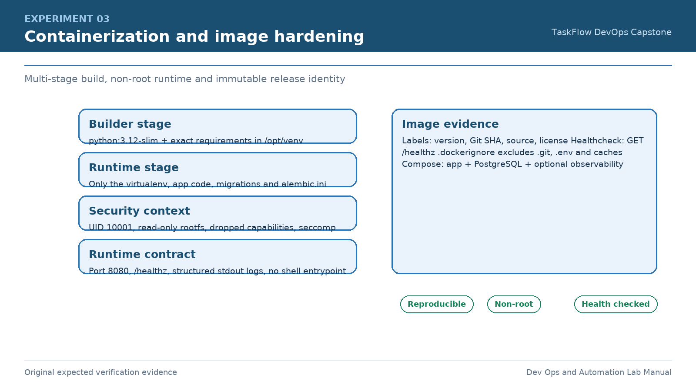 |

*Figure 3.1 - Multi-stage build, hardened runtime and release evidence*

### Observations

- A small runtime image with no build tools or development caches.
- A healthy TaskFlow container and a successful Alembic migration.
- Structured stdout logs suitable for collection by Promtail or a Kubernetes agent.

### Result

The application runtime is reproducible and self-describing. The image can be scanned, signed and promoted by digest in later experiments.

### Viva Questions

1. What security properties are provided by a non-root, read-only container?
2. Why is the database migration separated from application startup in Compose?
3. What is the difference between an image tag and an image digest?

---

## Experiment 4: CI Quality Gates and Supply-Chain Security

*Implement a fail-closed CI pipeline that tests, analyses, scans, builds, records and signs a release before it can be promoted.*

### Theory

CI converts a source commit into verified evidence. Unit and API tests establish behaviour; static analysis and dependency scanning detect unsafe code and known vulnerabilities; image and IaC scans detect deployment risks before release.

An SPDX SBOM, Buildx provenance and a keyless Cosign signature bind the artefact to a GitHub workflow identity. The resulting sha256 digest is the only value that later CD workflows are allowed to promote.

### Tools Required

GitHub Actions, pytest, Ruff, MyPy, Bandit, CodeQL, Gitleaks, Trivy, pip-audit, Syft SBOM, Buildx, Cosign, GHCR.

### Algorithm / Procedure

1. Install pinned dependencies and execute Ruff, MyPy and pytest with coverage.
2. Run CodeQL, Bandit, Gitleaks, Trivy and pip-audit as independent gates.
3. Build a local image on pull requests; scan it before any push is allowed.
4. On an approved branch, generate provenance, an SBOM and a keyless signature.
5. Publish the digest as a workflow artefact for the CD pipeline.

### Key Configuration (.github/workflows/ci.yml)

```text
jobs:
  quality:
    steps:
      - run: ruff check .
      - run: mypy app
      - run: pytest --cov=app --cov-report=xml
      - run: python tools/validate_repo.py
  security:
    steps:
      - uses: github/codeql-action/analyze@...
      - uses: aquasecurity/trivy-action@...
  container:
    needs: [quality, security]
```

### Verification

- A failing test, linter, type check or high-severity scan stops the pipeline.
- SARIF results appear in the GitHub Security tab for the analysed commit.
- The published image has an SBOM, provenance and a Cosign signature.
- The digest artefact matches the digest referenced by the signed image.

## Output

| CI gates | Expected evidence |
|---|---|
| **CI gates** | 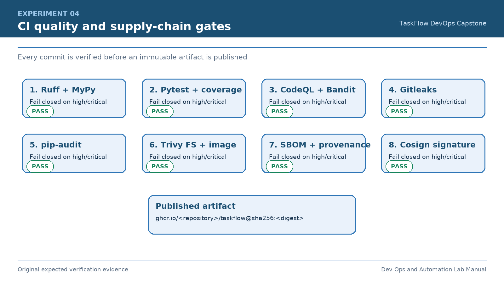 |

*Figure 4.1 - Sequential quality and supply-chain gates*

### Observations

- All quality checks pass for a clean commit and fail predictably for an unsafe one.
- A signed immutable digest in GHCR and an SPDX SBOM artefact.
- No plaintext credentials or mutable latest tag in the workflow.

### Result

A release candidate now carries evidence for correctness, dependency health, code security, image security, provenance and signer identity.

### Viva Questions

1. Why are SCA, SAST and secret scanning complementary rather than redundant?
2. What does keyless Cosign signing prove about an artefact?
3. Why should pull requests build but not push a release image?

---

## Experiment 5: Infrastructure Automation with Terraform and Kind

*Provision reproducible infrastructure as code and provide a no-cost local Kubernetes path with pinned platform components.*

### Theory

Infrastructure as Code replaces manual console actions with reviewed, versioned and repeatable state. A remote, encrypted, locked state backend prevents concurrent destructive changes and preserves the history needed for recovery.

The AWS root module separates dev, staging and production tfvars while keeping one reviewed module definition. The Kind bootstrap mirrors the same platform ideas locally with a four-node cluster and pinned Helm chart versions.

### Tools Required

Terraform, AWS VPC/EKS/ECR/RDS/S3/KMS/IRSA, S3 state, DynamoDB locking, Kind, Helm, kubectl.

### Algorithm / Procedure

1. Bootstrap the versioned S3 state bucket and DynamoDB lock table.
2. Fill each environment backend file with the bootstrap outputs.
3. Review terraform plan for the selected tfvars file before any apply.
4. Label resources by project, environment, owner and managed-by tags.
5. Run the Kind bootstrap to install the pinned local platform charts.

### Key Configuration (infra/terraform/main.tf)

```text
terraform {
  required_version = '>= 1.9.0'
  backend 's3' {}
}
module 'vpc' { source = 'terraform-aws-modules/vpc/aws' }
module 'eks' {
  cluster_version = var.kubernetes_version
  enable_irsa    = true
}
resource 'aws_db_instance' 'taskflow' {
  storage_encrypted = true
  deletion_protection = true
}
```

### Verification

- terraform validate reports no syntax errors after provider initialization.
- No .tfstate, .terraform directory or real credential is tracked by Git.
- Prod tfvars require Multi-AZ, 30-day backups and at least three nodes.
- Kind reports one control plane and three workers after bootstrap.

## Output

| IaC map | Expected evidence |
|---|---|
| **IaC map** | 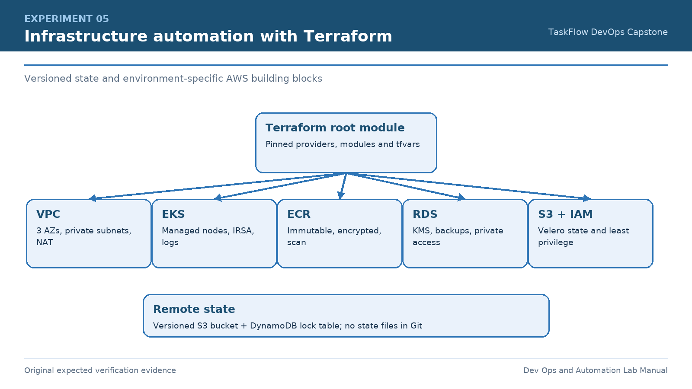 |

*Figure 5.1 - Terraform-managed AWS building blocks and remote state*

### Observations

- A reviewable plan showing VPC, EKS, ECR, RDS, S3, KMS and IRSA resources.
- Versioned remote state with a DynamoDB lock for concurrent safety.
- A local cluster with the same CRDs and platform chart versions pinned in versions.env.

### Result

The platform can be reproduced either in an AWS account or in a local Kind cluster. Both paths use reviewed declarative definitions rather than manual infrastructure changes.

### Viva Questions

1. Why is a locked remote state backend necessary for team infrastructure changes?
2. What is IRSA and why is it safer than long-lived AWS access keys in pods?
3. Which Terraform settings are deliberately different for production?

---

## Experiment 6: Kubernetes Orchestration and Declarative Manifests

*Deploy TaskFlow with resilient Kubernetes objects, security contexts, probes, scaling, network isolation and a schema migration hook.*

### Theory

Kubernetes orchestration turns a container image into a continuously reconciled service. A Rollout manages revision history, Services expose traffic, Ingress applies TLS and edge controls, and HPA/PDB protect availability during load or maintenance.

A PreSync Alembic Job separates schema change from pod startup. Readiness probes check the database, liveness probes check the process, and NetworkPolicies restrict ingress and egress to explicitly required peers.

### Tools Required

Kustomize, Argo Rollouts, Services, Ingress, cert-manager, HPA, PDB, NetworkPolicy, ServiceMonitor, Alembic Job.

### Algorithm / Procedure

1. Apply the environment overlay containing namespace, image digest and config patch.
2. Run the migration Job after its TCP database readiness check succeeds.
3. Start Rollout pods with non-root, read-only, seccomp and dropped-capability settings.
4. Expose the shared Service through TLS Ingress with WAF and rate-limit annotations.
5. Attach HPA, PDB, NetworkPolicy, ServiceMonitor and PrometheusRule to the workload.

### Key Configuration (base/rollout.yaml)

```text
kind: Rollout
spec:
  replicas: 3
  strategy:
    canary:
      stableService: taskflow-stable
      canaryService: taskflow-canary
  template:
    spec:
      automountServiceAccountToken: false
      securityContext:
        runAsNonRoot: true
        seccompProfile: {type: RuntimeDefault}
```

### Verification

- kubectl get rollout reports a Healthy phase and the expected replica count.
- Startup, readiness and liveness probes pass for every serving pod.
- The migration Job reaches Complete and the tasks table exists.
- NetworkPolicy allows ingress, monitoring and DNS/DB egress only as specified.

## Output

| Cluster objects | Expected evidence |
|---|---|
| **Cluster objects** | 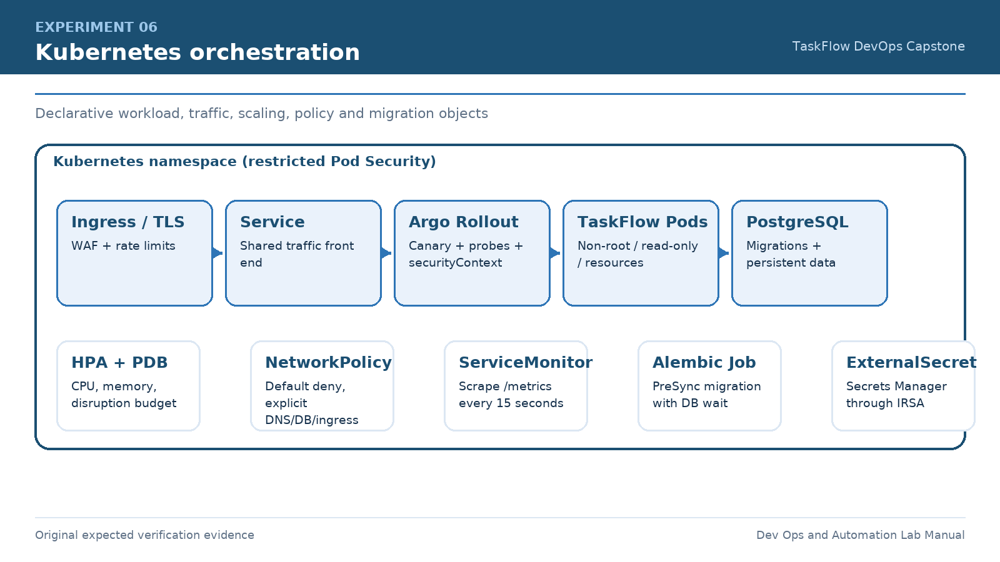 |

*Figure 6.1 - Kubernetes workload, traffic, scaling and policy objects*

### Observations

- A namespace containing Rollout, Services, Ingress, HPA, PDB and policy objects.
- No privileged pod, no latest-tag production image and no mounted service-account token.
- A successful smoke test from a temporary in-cluster client pod.

### Result

TaskFlow is now orchestrated declaratively. The cluster can heal pods, scale replicas, limit disruption, enforce isolation and migrate schema before accepting a new revision.

### Viva Questions

1. Why does a Rollout need both a shared Service and stable/canary Services here?
2. What failure would a readiness probe detect that a liveness probe would not?
3. How do NetworkPolicy and a Pod Security label enforce different boundaries?

---

## Experiment 7: GitOps Continuous Delivery and Environment Promotion

*Automate staging promotion from a signed digest and enforce an approval gate before production GitOps state changes.*

### Theory

GitOps makes the repository the desired state and lets an in-cluster controller reconcile drift. CD never mutates the cluster directly; it commits an immutable digest to an environment overlay, and Argo CD applies the reviewed Kustomize result.

Staging promotion is automatic after signature verification. Production promotion requires a protected GitHub Environment, a strict release-policy check, a Git commit with skip-ci and a release tag for auditability.

### Tools Required

GitHub Actions, Cosign, Argo CD, ApplicationSet, Kustomize overlays, GitHub Environments, release tags.

### Algorithm / Procedure

1. Download the signed sha256 digest produced by the successful CI workflow.
2. Verify the OIDC issuer and workflow certificate identity with Cosign.
3. Update the staging release manifest, ConfigMap and Kustomize image digest.
4. Run the release gate and commit only the staging overlay with [skip ci].
5. For production, invoke the approved workflow and enforce tools/verify_release.py.

### Key Configuration (tools/update_gitops.py)

```text
spec['image']['digest'] = args.digest
spec['image']['signed'] = True
spec['image']['verifiedBy'] = 'cosign-keyless'
spec['source']['commit'] = args.commit
spec['approval']['approvedBy'] = args.approved_by
images = kustomization.setdefault('images', [])
for item in images:
    item.pop('newTag', None)
    item['digest'] = args.digest
```

### Verification

- Reject a digest that is not a full lowercase sha256 value.
- Confirm Cosign verification uses the GitHub OIDC issuer and CI workflow identity.
- Confirm Argo CD reports Synced and Healthy for the environment Application.
- Confirm CI ignores the GitOps promotion commit and no workflow loop occurs.

## Output

| Promotion flow | Expected evidence |
|---|---|
| **Promotion flow** | 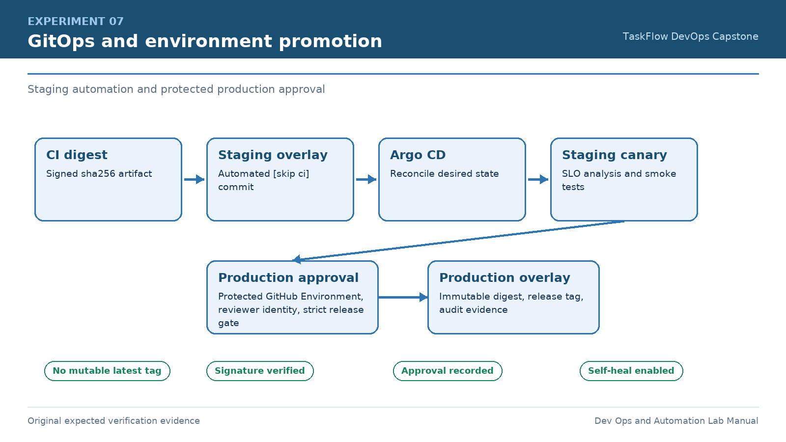 |

*Figure 7.1 - Signed digest promotion, GitOps sync and protected production approval*

### Observations

- A staging overlay referencing the exact signed digest from CI.
- A protected production approval record and an immutable release tag.
- An ApplicationSet managing dev, staging and production from one template.

### Result

The delivery lifecycle is automated but not uncontrolled: staging follows verified CI, production follows human approval and policy, and the cluster follows Git rather than ad hoc commands.

### Viva Questions

1. What does Argo CD self-heal protect against?
2. Why is the image digest, not a tag, written into the GitOps overlay?
3. How is production approval preserved as audit evidence?

---

## Experiment 8: Monitoring, Logging, SLO Alerts and Correlation

*Instrument the application and platform with metrics, structured logs, dashboards, alerts and a shared request-correlation mechanism.*

### Theory

Observability requires signals that can answer why a service is unhealthy. Prometheus counters and histograms provide rate, errors, duration and saturation; JSON logs provide event context; trace IDs connect a user request to logs and metrics across components.

The same metric names are used by steady-state PrometheusRule alerts and by Argo Rollouts canary analysis. This prevents a deployment gate from measuring a different definition of reliability than the production SLO.

### Tools Required

prometheus-client, ServiceMonitor, PrometheusRule, Grafana, Alertmanager, Loki, Promtail, JSON logging, W3C traceparent.

### Algorithm / Procedure

1. Expose bounded-cardinality request counters, latency histograms and readiness gauges.
2. Write single-line JSON logs with trace_id, request_id, route, status and duration_ms.
3. Provision the Grafana dashboard and Prometheus/Loki data sources.
4. Create alert rules for 5xx ratio, p95 latency, readiness and pod restarts.
5. Query one failed request by X-Trace-ID across logs, metrics and dashboards.

### Key Implementation (app/metrics.py)

```text
REQUESTS = Counter(
    'taskflow_http_requests_total',
    'Total HTTP requests handled by TaskFlow.',
    ['method', 'route', 'status'],
)
LATENCY = Histogram(
    'taskflow_http_request_duration_seconds',
    'HTTP request latency in seconds.', ['method', 'route']
)
READY = Gauge('taskflow_ready', 'Dependency readiness')
```

### Verification

- Prometheus scrapes the stable and canary Services every 15 seconds.
- The Grafana dashboard displays request rate, error ratio, p95 and readiness.
- A high 5xx ratio produces a critical alert after the configured for interval.
- A trace ID from a response header finds matching structured logs in Loki.

## Output

| Dashboards | Expected evidence |
|---|---|
| **Dashboards** | 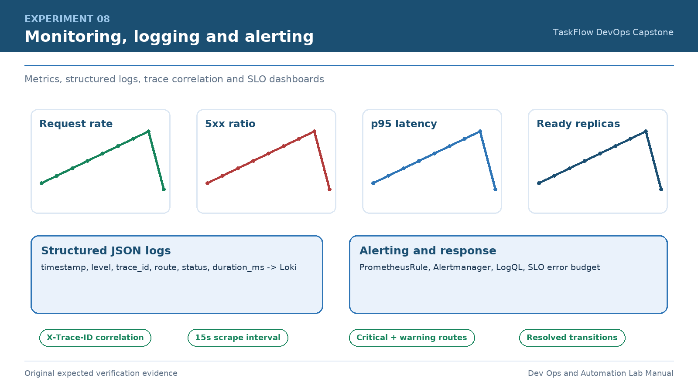 |

*Figure 8.1 - RED metrics, structured logs and SLO alert flow*

### Observations

- The /metrics endpoint exposes taskflow_build_info and RED metrics.
- Alertmanager groups critical and warning alerts and sends resolved transitions.
- LogQL queries return a single request across application and ingress logs.

### Result

The platform is observable from user request through deployment decision. Alerts, dashboards, logs and canary analysis share consistent SLIs and correlation IDs.

### Viva Questions

1. Why must metric route labels come from route templates rather than raw URLs?
2. What is the difference between an SLI, an SLO and an alert threshold?
3. How would you investigate a p95 latency alert using a trace ID?

---

## Experiment 9: Security Hardening, Secrets and Policy as Code

*Apply layered security controls across source, build, artefact, admission, runtime and incident-response boundaries.*

### Theory

No single scanner makes a platform secure. Controls should prevent unsafe changes, detect known weaknesses, verify artefact origin, constrain runtime privilege and limit the blast radius of a compromised component.

Production secrets are never stored in Git. External Secrets reads managed database credentials from AWS Secrets Manager using IRSA, while Kyverno validates pod properties and image signatures at admission time.

### Tools Required

CodeQL, Bandit, Gitleaks, Trivy, pip-audit, Cosign, Kyverno, Pod Security, NetworkPolicy, External Secrets, IRSA, TLS, CSP.

### Algorithm / Procedure

1. Enable secret, SAST, dependency, image and IaC scanning in CI.
2. Require signed images and immutable digests for production workloads.
3. Apply restricted Pod Security, NetworkPolicy and Kyverno admission policies.
4. Remove long-lived cloud keys; use IRSA and External Secrets for database access.
5. Review CSP, HSTS, rate limits, WAF annotations and the STRIDE threat model.

### Key Configuration (platform/security/kyverno-policies.yaml)

```text
kind: ClusterPolicy
spec:
  validationFailureAction: Enforce
  rules:
    - name: require-restricted-security-context
      validate:
        pattern:
          spec:
            securityContext:
              runAsNonRoot: true
            containers:
              - image: '*@sha256:*'
```

### Verification

- A privileged pod or latest-tag image is rejected by admission policy.
- A production container image has a verifiable Cosign signature.
- No production database URL, access key or private certificate is present in Git.
- The application sets CSP, nosniff, referrer and HSTS headers appropriately.

## Output

| Controls | Expected evidence |
|---|---|
| **Controls** | 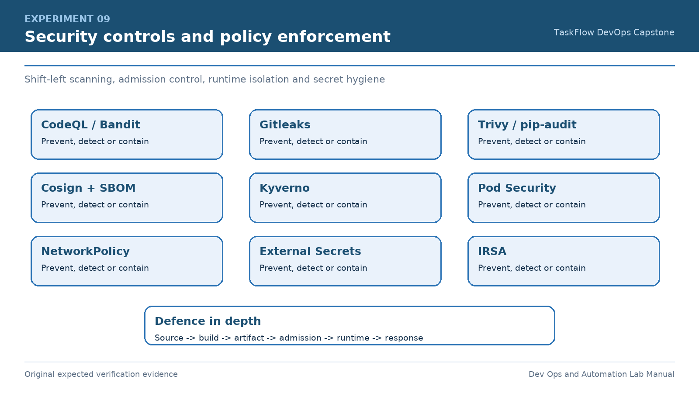 |

*Figure 9.1 - Defence-in-depth security controls across the delivery lifecycle*

### Observations

- Security findings are visible as SARIF or policy reports before deployment.
- Every production pod is non-root, read-only, capability-restricted and digest-pinned.
- Database credentials are injected at runtime from an external secret store.

### Result

Security is enforced by independent, reviewable controls from commit to runtime. A single compromised stage cannot silently change the application, cluster or credentials.

### Viva Questions

1. Map two controls in this platform to the STRIDE categories they mitigate.
2. Why is image-signature verification an admission-time control rather than only a CI check?
3. How does IRSA reduce the risk of credential theft compared with static AWS keys?

---

## Experiment 10: Canary Delivery, Rollback and Disaster Recovery

*Perform a metric-gated progressive deployment, verify automatic rollback, and document backup and recovery objectives for production readiness.*

### Theory

A canary release limits exposure by serving a small fraction of traffic from a new revision. Automated analysis compares the canary against error-rate, latency and readiness objectives; failure aborts the rollout before the whole fleet is affected.

Recoverability requires more than rollback. Git preserves desired state, Velero preserves cluster objects and volumes, RDS automated backups preserve data, and versioned Terraform state preserves infrastructure. Regular restore drills verify the stated RPO and RTO.

### Tools Required

Argo Rollouts, AnalysisTemplate, Prometheus, controlled failure injection, Velero, RDS snapshots, Git revert, runbooks.

### Algorithm / Procedure

1. Promote a new digest and move the canary to 20 percent weight.
2. Run three one-minute error-rate, p95-latency and readiness measurements.
3. Advance to 50 percent, repeat analysis, then promote to 100 percent only on success.
4. Execute a non-production drill with APP_FAILURE_RATE=1.0 and confirm automatic abort.
5. Review backup schedules and rehearse the documented restore sequence.

### Key Configuration (base/analysis-template.yaml)

```text
metrics:
  - name: canary-error-rate
    interval: 60s
    count: 3
    successCondition: result[0] < 0.02
    provider:
      prometheus:
        query: sum(rate(...status=~'5..'[5m]))
  - name: canary-p95-latency
    successCondition: result[0] < 0.5
```

### Verification

- A healthy release passes both analysis phases and reaches 100 percent.
- An injected 5xx failure produces a failed AnalysisRun and Degraded Rollout.
- Stable ReplicaSet pods remain Ready while the canary is aborted.
- Velero backup and RDS snapshot schedules exist with the documented retention.

## Output

| Canary timeline | Expected evidence |
|---|---|
| **Canary timeline** | 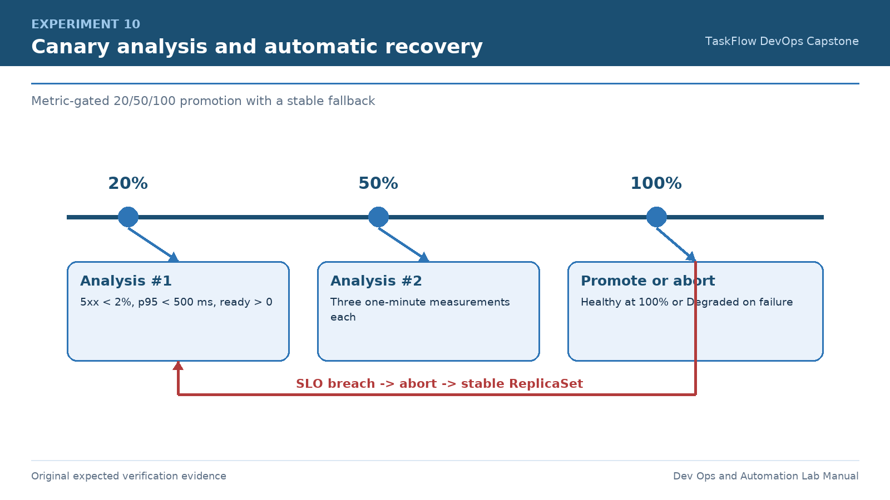 |

*Figure 10.1 - Metric-gated canary promotion and stable fallback*

### Observations

- An explicit 20/50/100 rollout history with analysis measurements.
- Automatic return to the stable ReplicaSet when SLOs are violated.
- Recorded RPO/RTO, restore steps and a rollout rollback procedure.

### Result

The platform automates full software delivery with observability, security and recoverability built in. A bad release is detected and aborted, while a regional failure can be restored from versioned Git, cluster and database backups.

### Viva Questions

1. Why does the canary threshold use a stricter error rate than the 30-day SLO alert?
2. What must be checked before rolling back an image that included a database migration?
3. Describe the restore order for a lost cluster and a corrupted database.

---

## Appendix A: Command Reference and Evidence Checklist

Use this command sequence to reproduce the capstone and collect the evidence required for each experiment.

### Local application and tests

- make install - create the virtual environment and a random local .env file.
- make test - execute the 11 API, metrics, validation and security-posture tests.
- make lint - run Ruff, MyPy, repository validation and pip-audit.
- make run - serve TaskFlow on port 8000 with a disposable SQLite database.

### Containers and local observability

- make compose-up - start TaskFlow and PostgreSQL after running Alembic migration.
- make compose-observability - add Prometheus, Loki, Promtail and Grafana.
- make docker-build - build the hardened taskflow:local image.

### Kubernetes, GitOps and recovery

- make kind-up - create the cluster, install pinned charts and apply the dev overlay.
- make verify-platform - wait for pods and run an in-cluster HTTP smoke test.
- make canary-drill - inject 5xx failures and observe an automated canary abort.
- bash infra/scripts/rollback.sh taskflow-dev - abort the active rollout.
- bash infra/scripts/backup-restore.sh --list - list available Velero backups.

### Quick Reference

```text
make install && make test && make validate
make lab-manual
python tools/validate_repo.py
python tools/verify_release.py --environment prod --allow-bootstrap
```

---

## Appendix B: Viva-Voce Preparation and Production Gate

Use these concise answers to connect the implementation to DevOps principles during evaluation.

### Core concepts

- CI answers whether a commit is safe to build; CD answers whether a verified artefact is safe to promote.
- GitOps makes Git the desired state and uses a controller to detect and correct drift.
- An immutable digest prevents a release identity from silently changing after approval.
- Observability is designed before deployment so canary analysis can make an objective decision.

### Reliability and recovery

- Automatic rollback handles a bad application revision; disaster recovery handles lost infrastructure or data.
- RPO describes acceptable data loss; RTO describes acceptable time to restore service.
- Schema compatibility must be checked whenever an application rollback crosses a migration boundary.
- A restore drill is required because an untested backup is not evidence of recoverability.

### Final production gate

- All automated tests and security scans pass for the candidate commit.
- The image digest is signed, scanned, SBOM-backed and workflow-identity verified.
- Production approval, canary analysis, rollback and backup evidence are present.
- Every platform configuration value has been generated from config/platform.env and the restore RTO has been measured.
- Bootstrap release scaffolds are marked taskflow.devops/state: bootstrap and cannot pass the strict production gate.

### Quick Reference

```text
Gate: python tools/verify_release.py --environment prod
Evidence: signed digest + Git SHA + AnalysisRun + dashboard + backup record
Outcome: approved immutable release, or automatic abort on SLO breach
```

---

## Appendix C: Local Host Implementation Evidence Screenshots

The screenshots were captured from the running local TaskFlow host, the generated implementation showcase and the verified GitHub Actions run. They provide visual evidence for every major area implemented in the capstone.

### What is shown

- The live TaskFlow UI, REST responses, OpenAPI contract and security/trace headers.
- Local quality gates, repository validation, tests and release-gate behavior.
- GitHub Actions quality, security, container scanning, SBOM and keyless signing.
- The application, tools, Terraform, GitOps, observability, security, backup and runbook inventory.
- All ten generated architecture/evidence diagrams and a complete screenshot gallery.

### How to reproduce

- Start the app with HOST=0.0.0.0 PORT=8010 and a disposable SQLite database.
- Run make evidence to capture local screenshots and regenerate this manual.
- Run make evidence-showcase to serve the interactive screenshot gallery.
- Use the standalone implementation-evidence PDF for a screenshots-only copy.

### Quick Reference

```text
make evidence
make lab-manual
make evidence-showcase
Open docs/implementation-showcase/Implementation-Evidence-Screenshots.pdf
```

### Figure C.1 - Template-styled capstone cover

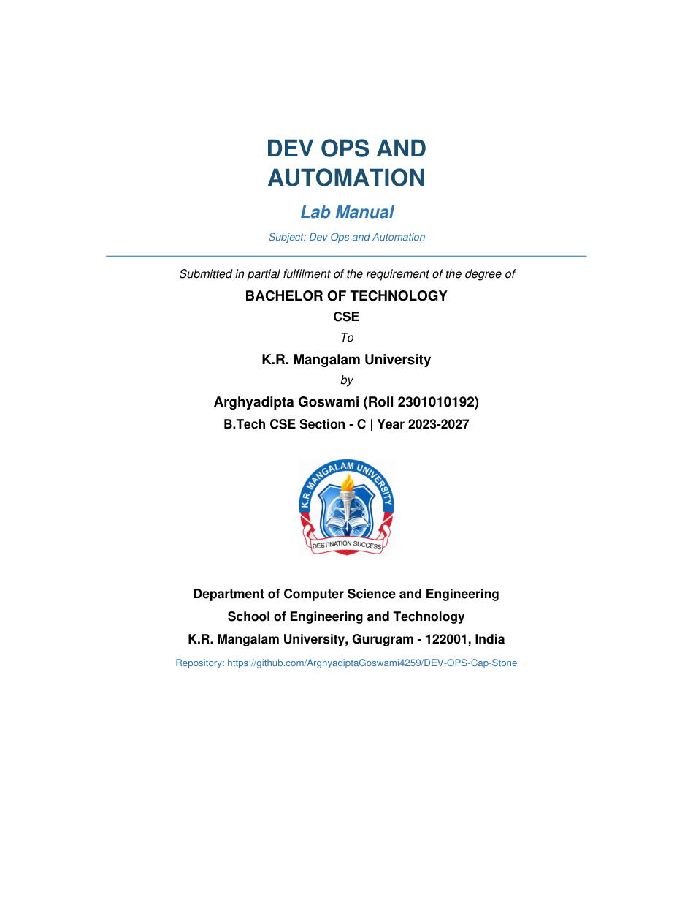

*The requested cover design, student metadata and clickable repository link.*

---

### Figure C.2 - TaskFlow on the local host

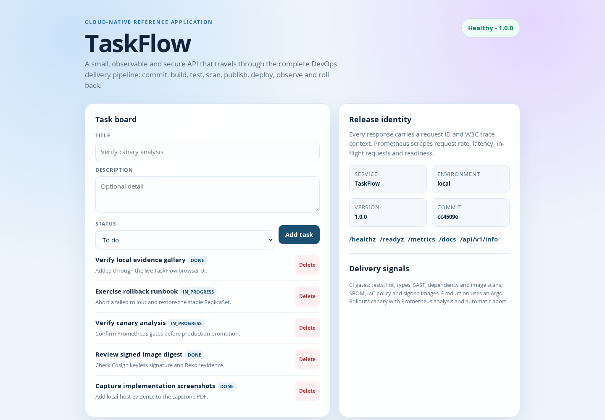

*Live browser UI on 0.0.0.0:8010 with health, release identity and task CRUD.*

---

### Figure C.3 - Live API and response headers

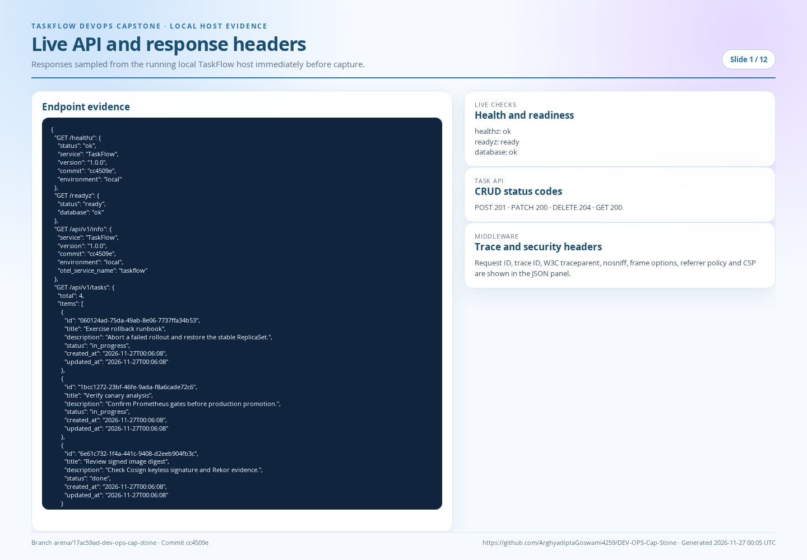

*Actual local-host responses for health, readiness, metadata, tasks and metrics.*

---

### Figure C.4 - OpenAPI contract and routes

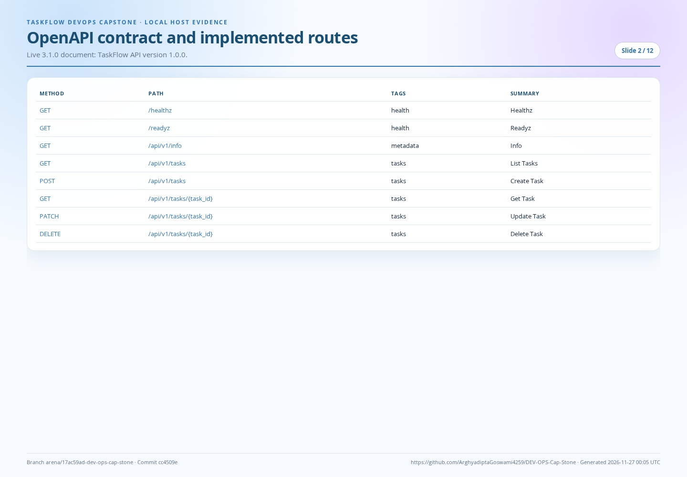

*Generated OpenAPI 3.1 contract showing the implemented TaskFlow operations.*

---

### Figure C.5 - Local quality and validation gates

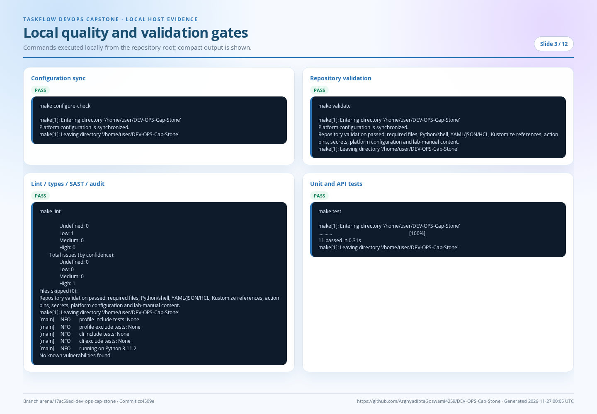

*Configuration sync, repository validation, lint, typing, SAST, audit and tests.*

---

### Figure C.6 - GitHub Actions delivery run

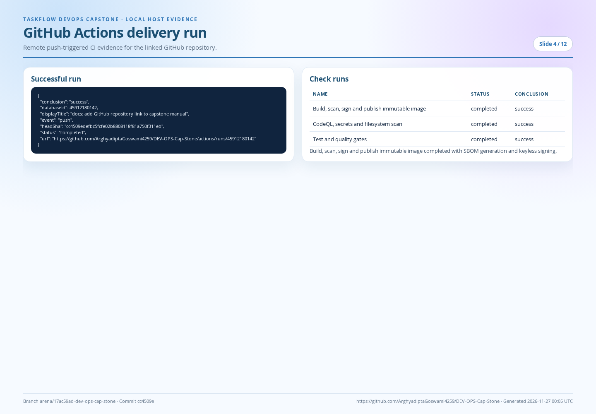

*Successful push-triggered CI run with quality, security and signed-image jobs.*

---

### Figure C.7 - Implemented component inventory

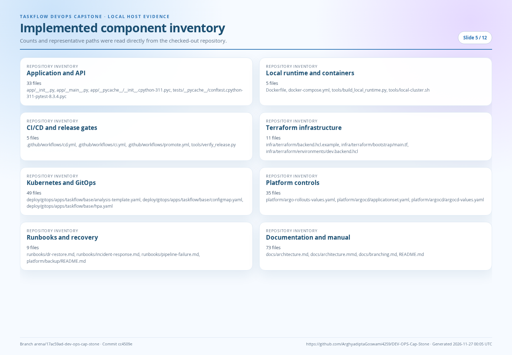

*Repository-wide inventory of application, runtime, CI/CD, infrastructure and controls.*

---

### Figure C.8 - Architecture and evidence diagrams

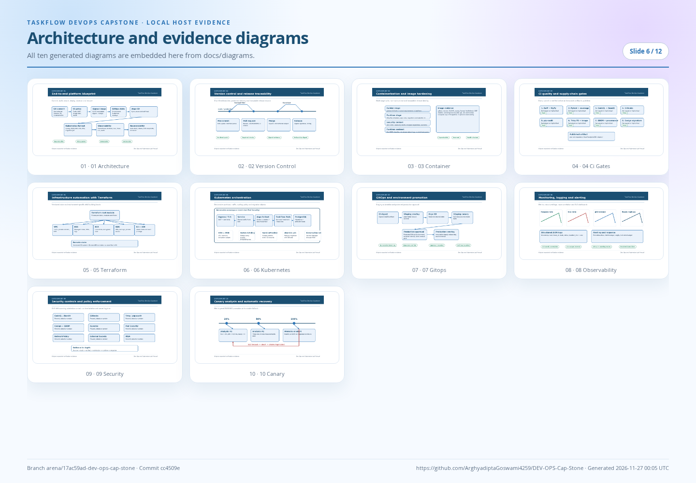

*All ten generated diagrams covering architecture, delivery, security and canary flow.*

---

### Figure C.9 - CI/CD and promotion workflows

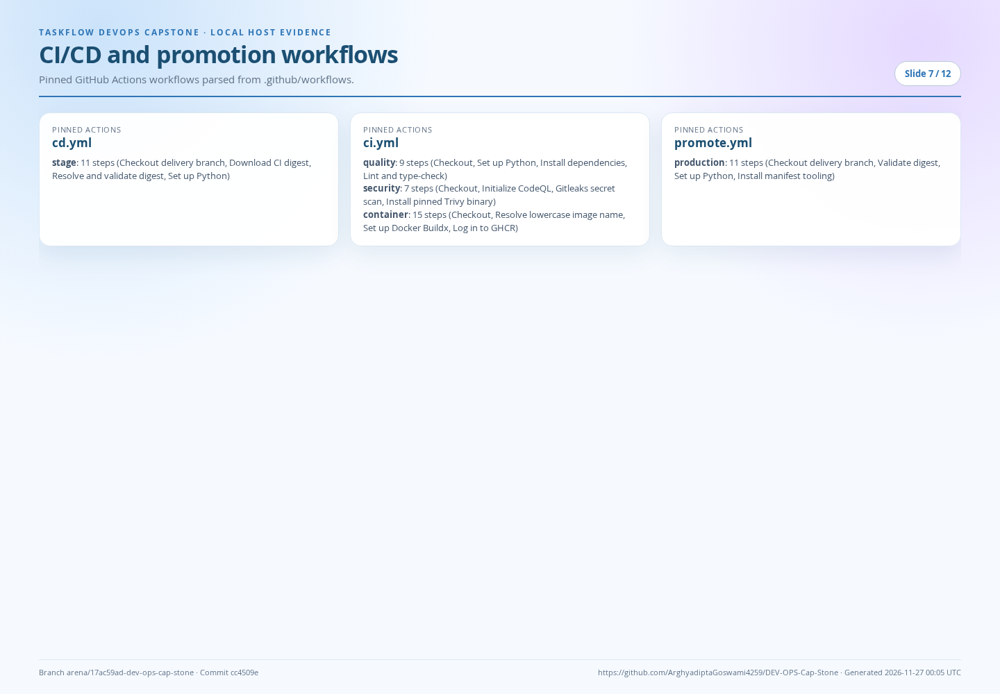

*Pinned GitHub Actions jobs for CI, staging CD and production promotion.*

---

### Figure C.10 - Terraform and GitOps inventory

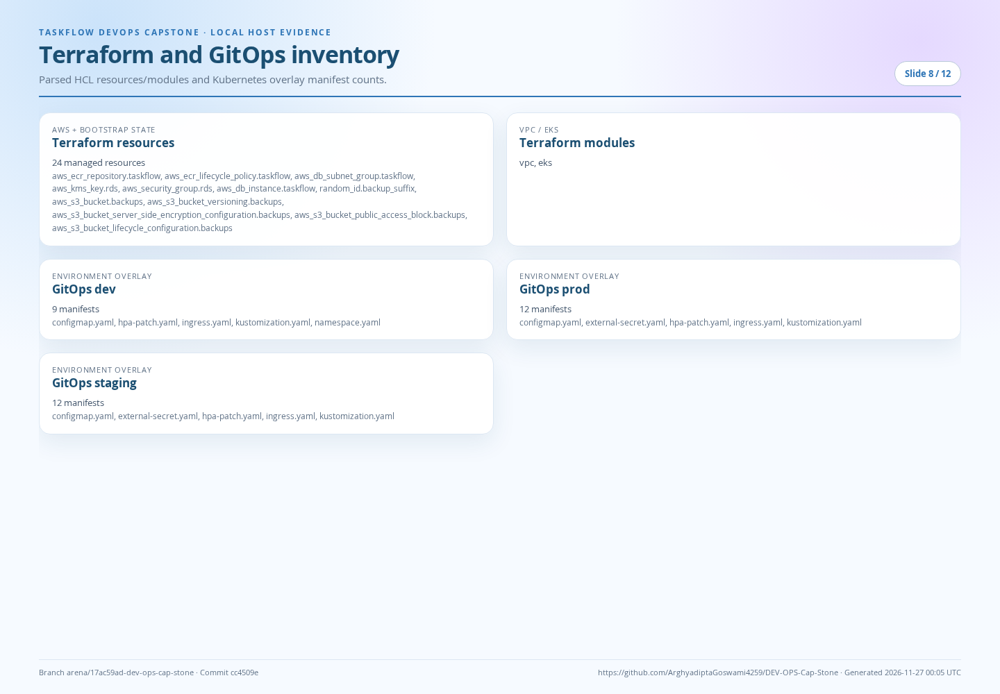

*AWS resources, environment overlays, bootstrap state and hardened delivery manifests.*

---

### Figure C.11 - Security and supply-chain controls

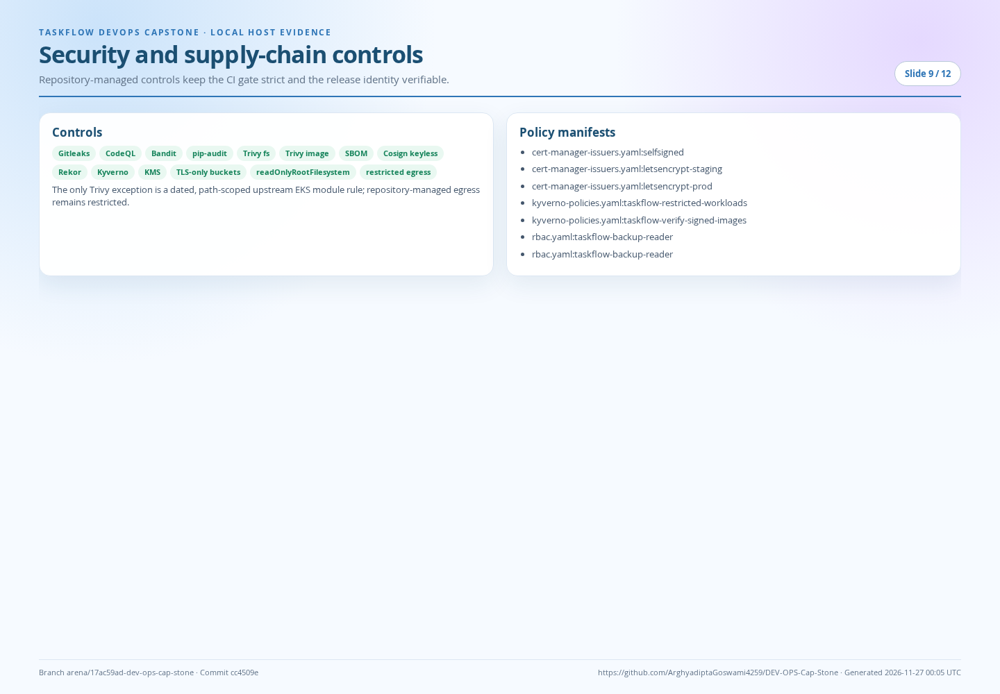

*Secret scanning, SAST, IaC/image scans, policy, SBOM and keyless image signing.*

---

### Figure C.12 - Observability, SLO and recovery

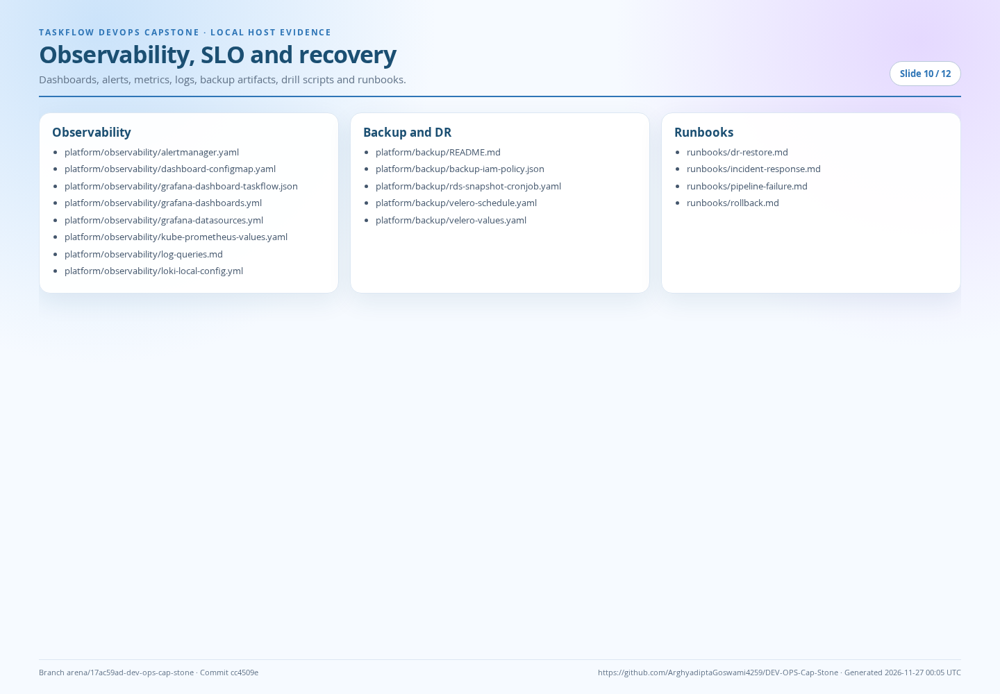

*Prometheus, Grafana, Loki, Alertmanager, SLO, backup, restore and runbooks.*

---

### Figure C.13 - Local runtime and release gates

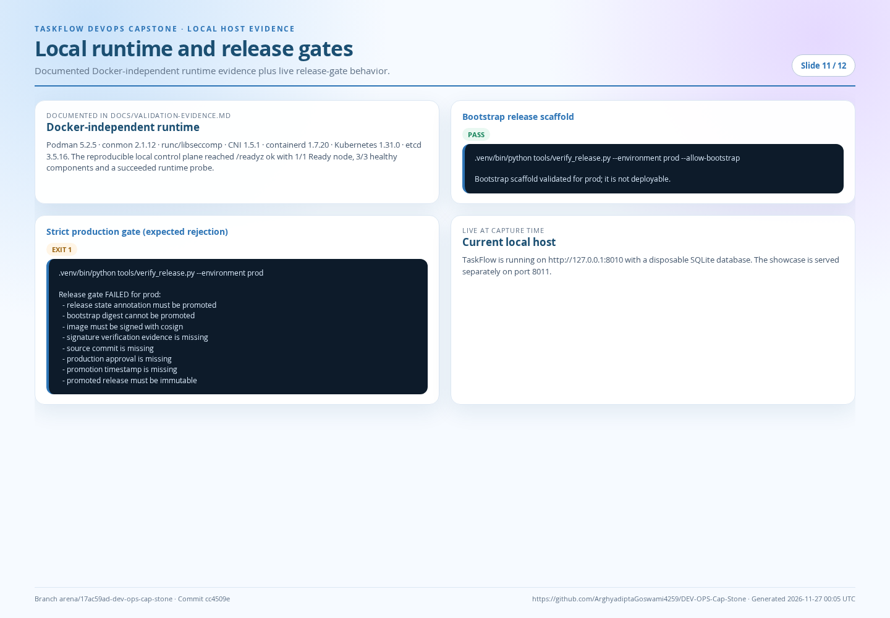

*Documented Docker-independent runtime evidence plus bootstrap and strict release gates.*

---

### Figure C.14 - Complete implementation evidence gallery

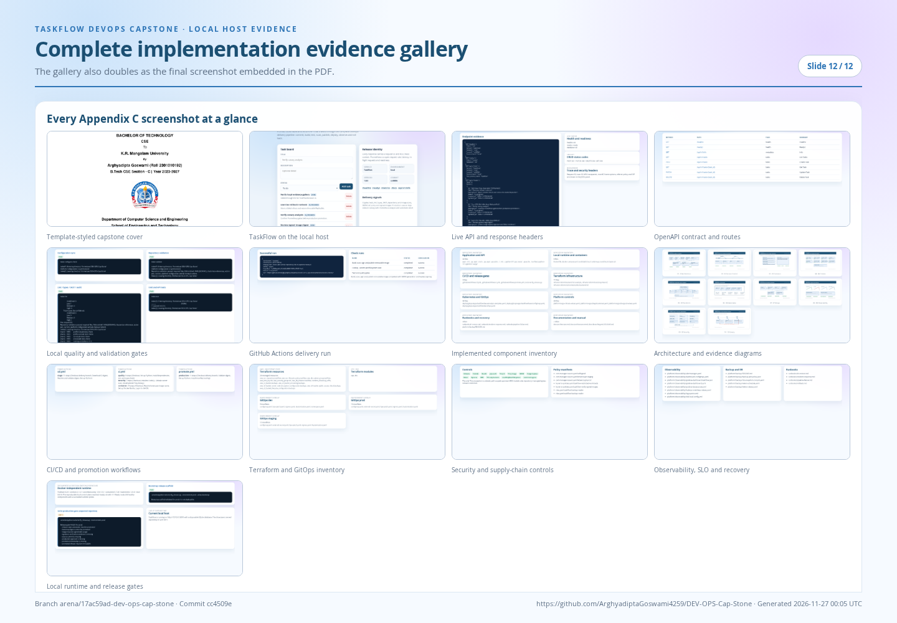

*Single-page index of every screenshot embedded in Appendix C of the PDF.*

---

---
